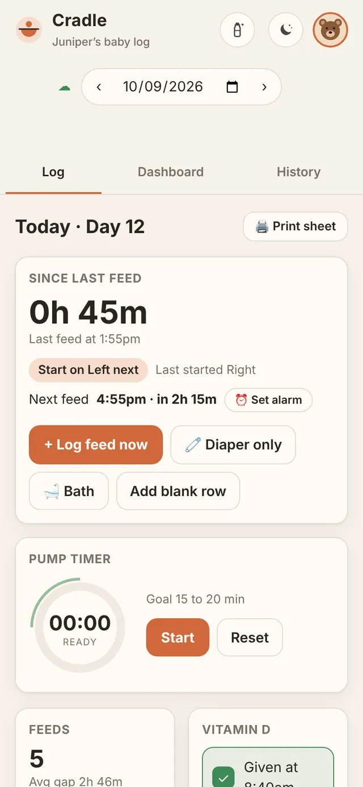
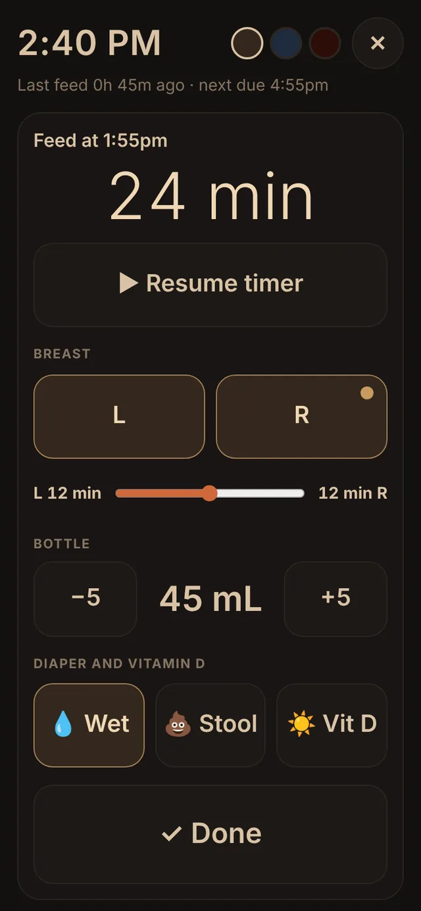
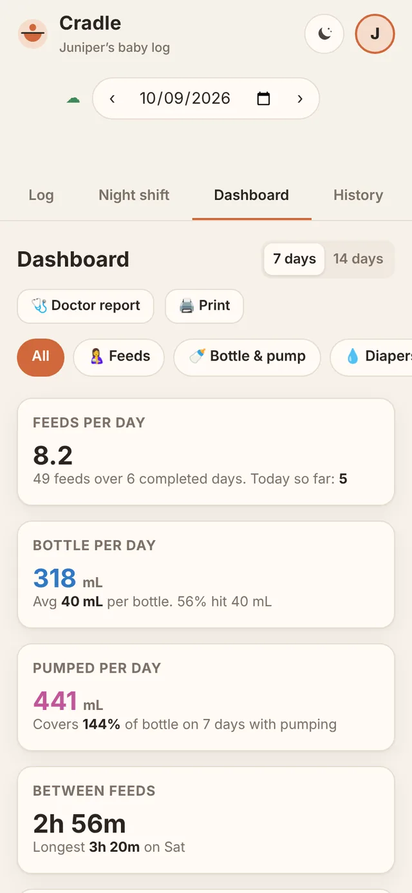
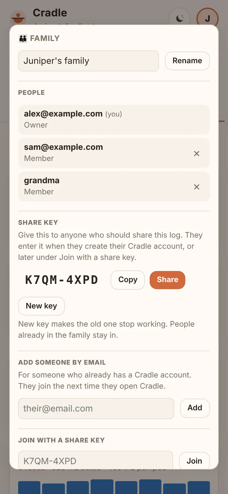

<p align="center">
  
</p>

<h1 align="center">Cradle</h1>

<p align="center"><a href="https://github.com/skboyce28/Cradle/actions/workflows/tests.yml"></a></p>

<p align="center"><b>A baby log for tired parents.</b><br>
Nurse, bottle, pump, diapers, Vitamin D, baths, tummy time, and sleep, shared live between family phones and usable one-handed at 3am. Built for triple feeding, and just as handy if you only nurse or only bottle feed: turn off what you don't use in Settings and it's hidden everywhere.</p>

> [!IMPORTANT]
> **Cradle is not medical advice.** It is a notebook, not a clinical tool. Feeding and diaper goals in the app are placeholders: always follow your pediatrician, lactation consultant, or care team. **Cradle was built with AI assistance (Claude, by Anthropic).** The code was written and reviewed with an AI model, has not been independently audited, and comes with no warranty. See [DISCLAIMER.md](DISCLAIMER.md).

<p align="center">
  
  
  
  
</p>
<p align="center"><sub>Screenshots show example data for a made-up baby. Product overview: <a href="docs/overview.html">docs/overview.html</a>, also published with your Cradle at <code>/overview/</code>.</sub></p>

---

## What it does

| | |
|---|---|
| **Log** | One row per feed: left/right breast (with which side you started), nursing minutes with a ▶ timer, a slider that splits the minutes between sides, bottle mL, pump mL, wet, stool, Vitamin D, notes. 🧷 diaper-only and 🛁 bath rows (sponge or tub) that don't count as feeds. |
| **Night shift** | The bottle button at the top right opens a dim, low-glare screen with huge buttons for one-handed night feeds, plus quick Diaper only and Bath buttons. Warm, Moonlight, or Red colors. |
| **Dashboard** | 7 or 14 days of trends, with filter chips to show one topic at a time: feeds, nursing minutes, bottle and pump volume, diapers against goals, Vitamin D, baths, tummy time, sleep, side balance and time on each side, longest stretch, weight against birth weight. Tap any chart to enlarge and explore it. Today shows as "in progress" until midnight. |
| **Tummy time** | 🤸 starts a timer and logs the minutes (or type them), with a daily goal in Settings, progress on the Log, and a Dashboard chart. |
| **Sleep** | Optional (turn it on in Settings). 😴 Asleep and ☀️ Woke up, on the Log and in Night shift, shared live with the family. Naps and night sleep, the wake window, a daily goal, and a Dashboard chart. |
| **History** | Every day at a glance, as cards or a table. |
| **Next feed** | When the next feed is due, with an in-app chime, vibration, Snooze, and Dismiss. |
| **Owlet Dream Sock** | Optional: connect the sock in Settings and sleep is logged automatically for the whole family. The password is used once; the sign-in token is kept encrypted with a key only your Edge Function has. Unofficial, since Owlet has no public API. |
| **Notifications** | Optional: a notification on each phone that asks, even with Cradle closed, when a feed is due or 15 or 30 minutes before. Sent by a small Supabase Edge Function in your own project. |
| **Calm** | The 🌙 button at the top right: a slow screensaver with the time, time since the last feed, and spa music, ocean, rain, or white noise. |
| **Doctor report** | One printable page for appointments, from the Dashboard: weight, feeds, nursing time by side, volumes, diapers, Vitamin D, baths, tummy time, and sleep. Every tab also prints. |
| **Weighted feeds** | Before and after weights on a feed, in grams or lb and oz, with the estimated transfer (1 g ≈ 1 mL). |
| **Weights** | A list of every weight to review, edit, or delete, and a chart against birth weight. |
| **Milk storage** | Pumped milk in the fridge and freezer, oldest first, with CDC age limits flagged. Thaw, freeze, or use a container (it can log the bottle feed). Optional labels: type them, scan barcodes, or print Cradle's own. |
| **Achievements** | Fifty-five badges in nine groups, with starred higher tiers, like a 7-, 14-, and 30-day Vitamin D streak. |
| **Learning center** | High-contrast black-and-white cards to show your baby during calm, awake moments, full screen, with invert and auto-advance. |
| **Profile pictures** | A photo or a built-in picture (silhouettes and animals) for each person, shown on the profile button and the Family screen. Each person chooses who sees it: only them, their family, or everyone on the Cradle (also on the high-score boards). |
| **Fun center** | **Bottle Catch**: a two-minute, one-thumb arcade game. **Daily Word**: a new word every day to guess in 6 tries, at 4, 5, or 6 letters (each person picks), with hard mode, streaks, and practice. **Stork Flight**: tap to flap a stork through the clouds and chimneys over a sleeping town, with stars and deliveries. All three have high scores (3 initials) for everyone, your family, and you. |
| **Support** | 💬 in the profile menu: send a bug, idea, or question with an optional screenshot, and see its status and reply. Admins get a Feedback inbox in the app. Reviewed feedback earns two achievements. |
| **Family sharing** | Everyone signs in with their own account; a family shares one log that syncs within about 15 seconds. Join with a share key like `K7QM-4XPD`. |
| **Two-step sign-in** | Optional 6-digit codes from an authenticator app after the password. The family owner can require it for everyone, and the database enforces it. |
| **Works offline** | Every phone keeps its own copy and catches up when it reconnects. Installs to the home screen like an app. |
| **Status page** | `/status/` shows whether the site and database are up, 90 days of uptime, what's deployed, and recent deployments with their test results, each with its own link. Counts only, nothing personal. |
| **Your data, your database** | Sync runs through **your own** free Supabase project. No analytics, no ads, no third-party scripts. Export to a file or a text message at any time. |

Diaper goals follow the baby's day of life: 1 wet and 1 stool on the birth day (Day 0), then the day number on days 1 to 5, then at least 4 of each per day. All goals can be changed in Settings.

## Quick start

Cradle opens to a sign-in screen, so it needs a database to sign in to: a free Supabase project of your own. Setup takes about 15 minutes:

1. **Create a Supabase project** and run the two scripts in [`supabase/`](supabase/) in order.
2. **Turn on sign-ups** and **turn off email confirmation** in Supabase.
3. **Put your project address and publishable key** in environment variables: `.env` on your computer, or Netlify's environment variables. Never in the repo.
4. **Build and deploy** to Netlify (drag and drop, or connect this repo).
5. **Open the site on your phone**, tap *Create an account*, and install it to your home screen.
6. **Optional: notifications.** Three more steps in Supabase (the schedule must call the function's web address exactly, capitals included) so phones can be told when a feed is due: [docs/notifications.md](docs/notifications.md).

Step by step, with where to click: **[docs/setup.md](docs/setup.md)**.

## Documentation

| Guide | What's in it |
|---|---|
| [Setup](docs/setup.md) | Supabase, Netlify, installing on phones, updating |
| [Accounts and families](docs/accounts-and-families.md) | Sign-up, share keys, owners and members, who can see what |
| [Using Cradle](docs/using-cradle.md) | Every screen and feature, for the people doing the feeding |
| [How it works](docs/how-it-works.md) | Architecture, sync, data model, database rules, security |
| [Deployment and architecture](docs/deployment.md) | How it's deployed (GitHub, Netlify, Supabase), the schema, admin queries, and the design decisions behind it |
| [Notifications](docs/notifications.md) | Optional feed-due notifications: using them, the 10-minute setup in Supabase, how they work, privacy |
| [Owlet Dream Sock](docs/owlet.md) | Optional automatic sleep from the sock: connecting, how sleep is detected, the setup in Supabase, privacy |
| [Troubleshooting](docs/troubleshooting.md) | Sign-in problems, missing data, sync, alarms, printing |
| [Product overview](docs/overview.html) | A one-page visual tour with screenshots. Your Netlify site publishes it at `/overview/` (for example `https://your-cradle.netlify.app/overview/`), which is the easiest link to share. |
| [Changelog](CHANGELOG.md) | What changed in each version |

## Repository layout

```
cradle.html            The whole app: one file, no dependencies
LICENSE.md             PolyForm Noncommercial 1.0.0
THIRD-PARTY-NOTICES.md Credits and license for Daily Word's word lists (SCOWL)
build_pwa.py           Builds the installable web app into pwa/ (python3 build_pwa.py)
.env.example           Template for your Supabase address + publishable key (copy to .env, which git ignores)
icons/                 App icons used by the build
supabase/
  1-setup.sql          Step 1: the log table
  2-family.sql         Step 2: families, accounts, share keys, Fun center high scores
  3-notifications.sql  Optional: feed-due notifications (phones, keys, due times)
  4-notify-schedule.sql  Optional: runs the cradle-notify function every minute
  functions/cradle-notify/  The Edge Function that sends the notifications
  admin-queries.sql    Queries for running Cradle: confirm accounts, find families, fix problems
  invite-email.html    Optional "Welcome to Cradle" email template
netlify.toml           Lets Netlify build and publish straight from this repo
tools/words/           Builds Daily Word's word lists into cradle.html
tools/screenshots/     Retakes the screenshots in docs/ with the made-up baby
tests/                 Over 300 automated checks; run on every push by .github/workflows/tests.yml
docs/                  The guides above, the product overview page, and screenshots
```

`pwa/` is a build output and isn't committed.

## Privacy and security in one paragraph

Your log lives in your browser and in **your** Supabase project; it never touches a server run by anyone else. (If you turn on notifications, an encrypted "feed due" message passes through Google's, Apple's, or Mozilla's push service, which can't read it.) The database itself enforces who sees what (Postgres row-level security), so one family can never read or change another family's log, even with a modified copy of the app. With two-step sign-in on (or required by the family owner), a password alone isn't enough either. Your project address and publishable key stay out of the repo, in `.env` or your host's environment variables. The publishable key is designed to be seen by browsers, so it's visible in the hosted page; the database rules are what protect the data. The hosted site also sends strict security headers: it only runs Cradle's own code, only talks to your Supabase project, and can't be embedded in other sites. **Never** put your `sb_secret_…` key in this repo or the app. As the project owner, you can see every family's rows in the Supabase dashboard; tell people that if you share your Cradle with friends. More in [How it works](docs/how-it-works.md#security).

## Known limits

- **The in-app alarm only rings while Cradle is open.** Phones don't let web apps create Clock alarms, even installed, so **⏰ Set alarm** shows the time to set by hand. With the app closed, turn on [notifications](docs/notifications.md) instead (needs the optional setup; on iPhone, Cradle must be on the Home Screen).
- **No password reset email** unless you connect your own email sender (SMTP) in Supabase. Encourage people to sign up with a real email.
- **Free Supabase projects pause after about a week without use.** Daily logging keeps it awake; a paused project can be restored from the dashboard.
- **One baby per family.** Twins or siblings would each need their own family for now.
- **High scores are checked, not cheat-proof.** The server refuses impossible scores and takes one Daily Word result per day, but like any web game, a determined cheater could post a believable fake. Daily Word's word lists are inside the app, so the answer isn't secret from someone who goes looking.

## Built with AI

Cradle was designed by its author and built with **Claude**, an AI model made by Anthropic. The AI wrote most of the code, the database scripts, and these docs, and tested them in a simulated environment (a real Postgres database with stand-ins for Supabase's sign-in service, driven by an automated browser). That testing is not the same as an independent security review or clinical validation. Read the code before you trust it with anything important, and report problems in [Issues](../../issues).

## License

Cradle is licensed under the **[PolyForm Noncommercial License 1.0.0](LICENSE.md)**.

- **You can** use it, change it, and share it for any noncommercial purpose: your own family, friends, hobby projects, study, and charities, schools, or public health organizations.
- **You can't** use it commercially, for example selling it, charging for a hosted version, or building it into a paid product, without separate permission. Open an issue to ask.
- Anyone you share it with must get the license terms and this notice: `Required Notice: Copyright (c) 2026 skboyce28 (https://github.com/skboyce28/Cradle)`.

Daily Word's word lists come from [SCOWL](http://wordlist.aspell.net/), Copyright 2000-2016 Kevin Atkinson, used under its permissive license: see [THIRD-PARTY-NOTICES.md](THIRD-PARTY-NOTICES.md).

PolyForm Noncommercial is source-available, not "open source" by the Open Source Initiative's definition, because it limits commercial use.
